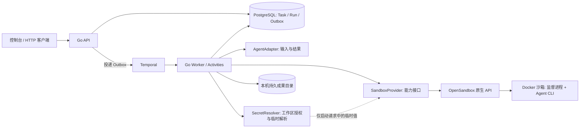
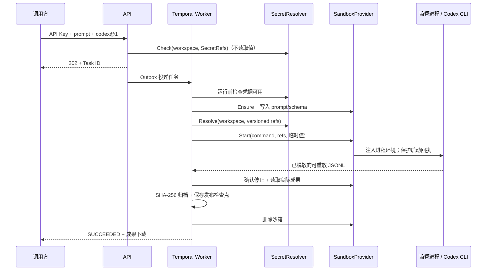

# makez 本机实现与验收

2026-10-18。基础设施闭环使用 Go + Temporal + PostgreSQL + OpenSandbox，现增加 `codex@1` 真实 CLI Adapter 和工作区级 SecretRef。默认仍可用确定性的 Demo Agent 检查基础设施。

## 启动与查看

宿主依赖：Go 1.26+、Docker（Compose v2.20+）、jq、OpenSSL。Temporal 和 OpenSandbox 由 Compose 运行，无需在宿主安装 Temporal CLI 或 uv/uvx。镜像使用 PostgreSQL 17、Temporal CLI 1.9.1（Server 1.32.0）和 OpenSandbox Server 1.1.1。

```sh
make dev
```

首次生成 `.local/env` 中的本机密钥，执行 `docker compose up -d --wait` 等待三个基础服务健康，再构建沙箱镜像和 Go 程序。`dev.sh` 最后通过 `exec` 运行本机 API/Worker，日志直接输出到终端。将启动时打印的 Key 填入控制台后，可以提交任务、查看日志、取消任务和下载成果。

- 控制台/API：`http://127.0.0.1:8088`
- Temporal UI：`http://127.0.0.1:18233`
- Temporal gRPC：`127.0.0.1:17233`
- OpenSandbox：`127.0.0.1:18080`
- PostgreSQL：`127.0.0.1:55432`

Ctrl+C 只停止 Go API/Worker，三个基础服务继续运行。首次完成 `make dev` 后，可独立管理基础服务：

```sh
make infra-up    # 启动并等待健康检查；可重复执行
make infra-ps    # 查看状态
make infra-logs  # 查看服务日志
make infra-down # 停止并移除服务容器，保留数据
```

直接使用 Compose 时，先 `source .local/env`；首次启动还需 `docker volume create makez-postgres`（`make dev` / `make infra-up` 会自动完成）。例如 `docker compose logs -f opensandbox`，或 `docker compose exec temporal temporal workflow list`。`infra-down` 前先结束任务；脚本不会自动停止旧环境或占用端口的其他进程。

若出现 `bind: address already in use`，说明 API 地址已被占用。用 `lsof -nP -iTCP:8088 -sTCP:LISTEN` 找到进程，在其原终端按 Ctrl+C 停止后再运行 `make dev`；也可设置 `MAKEZ_LISTEN=127.0.0.1:8089 make dev` 使用另一个端口。程序在启动 Worker 之前绑定 API 端口，绑定失败不会打印 `makez console ready`。

| 数据 | 存放位置 |
|---|---|
| Task / Run / Outbox / 成果元数据 | Docker volume `makez-postgres` |
| Temporal 历史 | `.local/temporal/temporal.db` 及同目录 SQLite 辅助文件 |
| OpenSandbox 状态 | `.local/opensandbox/opensandbox.db` 及同目录 SQLite 辅助文件 |
| 已交付成果、密钥配置 | `.local/artifacts/`、`.local/env`、自己的 SecretRef 文件 |

Compose 只挂载各服务自己的数据目录；认证快照和成果目录不挂载给基础服务。PostgreSQL 使用声明为 `external` 的 `makez-postgres` volume，启动入口幂等创建或复用它，Compose 只挂载、不管理它的删除；不要手动删除需要保留的数据卷。

`compose.yaml` 定义端口、数据挂载和健康检查，`configs/opensandbox.toml` 定义 OpenSandbox 行为，API Key 通过服务环境注入。OpenSandbox 挂载本机 Docker socket，与创建的沙箱共用 `makez-sandboxes` 网络，服务端代理使用内部地址；对宿主发布的端口均绑定 `127.0.0.1`。这个配置用于可信本机开发。当前沙箱能力仍不包含网络白名单；将来启用 OpenSandbox 的 egress/networkPolicy 时需要重新设计其网络拓扑。

Temporal 继续使用持久化开发服务器及内置 UI，按 [Temporal 官方本地开发方式](https://docs.temporal.io/cli/setup-cli)运行于容器。它与业务 PostgreSQL 独立，不需要引入生产集群初始化流程。

### 旧开发环境迁移

旧版使用 `.local/temporal.db`、`.local/opensandbox.db` 和独立的 `makez-postgres` 容器。先等待旧任务结束，再用旧终端的 Ctrl+C 停止 API/Worker、Temporal 和 OpenSandbox，确认进程已经退出。不要在旧进程写 SQLite 时移动文件。

以下命令适用于这两个旧数据库都已存在、目标目录尚未迁移的情况；一同保留 SQLite 的 WAL/SHM 等辅助文件：

```sh
docker stop makez-postgres
umask 077
mkdir -p .local/compose-migration-backup .local/temporal .local/opensandbox
cp -pn .local/temporal.db* .local/opensandbox.db* .local/compose-migration-backup/
mv -n .local/temporal.db* .local/temporal/
mv -n .local/opensandbox.db* .local/opensandbox/
make dev
```

若仅有一个旧数据库，只迁移对应的一组文件；不要覆盖目标目录中已有的数据库。`dev.sh` 检测到旧路径会停止并提示迁移，避免悄悄创建空的历史库。Compose 通过 `external: true` 复用原 `makez-postgres` volume；旧 PostgreSQL 容器保持停止，不要与新容器同时启动。`.local/env`、SecretRef 注册表和成果路径保持不变。

`cmd/makez` 支持 `all`、`api`、`worker` 三种模式。同一代码库可以将 API 与 Worker 分别运行。API 使用延迟连接 Temporal，Temporal 不可用时仍能接收并持久化任务。

## 当前模块

| 位置 | 已实现职责 |
|---|---|
| `internal/core/contracts.go` | SandboxProvider / AgentAdapter、能力与状态类型；不依赖 Temporal 或 OpenSandbox |
| `internal/api` | 工作区 API Key、输入校验、任务/成果查询、SSE 重放、内嵌本机控制台 |
| `internal/store` | PostgreSQL 事务、状态约束、幂等请求、Outbox、操作意图、日志游标和归档检查点 |
| `internal/workflow` | Task / Cleanup / Recovery Workflow，Activity、Outbox 投递和异常对账 |
| `internal/sandbox` | OpenSandbox 原生生命周期 API、归属检查、运行时控制；平台接口不绑定 E2B |
| `cmd/sandboxd` / `internal/sandbox/supervisor` | Go 沙箱监督服务：唯一启动回执、停止墓碑、逃逸子会话停止、日志与文件访问 |
| `cmd/codex-runner` / `internal/agent/codexrunner` | Go Codex 启动器：临时认证目录、固定 CLI 参数、结果清单交接 |
| `internal/agent` | Demo、通用 CLI、Codex Adapter；生成输入和固定命令、解码 JSONL、解释成果；CLI 自带推理循环 |
| `internal/secret` | 工作区授权、版本化引用、环境变量/私密文件解析；值只在执行 Activity 内存中存在 |
| `internal/artifact` | 16 MiB/文件、64 MiB/Run、SHA-256、原子归档及安全读取 |



一个 Task 只有一个业务 Run。Prepare / Launch / Observe 的 Activity 重试保留该 Run；创建和启动先保存一次性操作意图，失去响应后只查询已有资源/启动凭据。Observe 重试重新获取观察者 epoch，原子保存事件和游标，旧观察者无法继续提交。

Finalize 先确认 Agent 已停止，排空输出并归档，然后把待发布结果和文件存储键写入 PostgreSQL，再删除沙箱并发布终态。删除失败会与终态一起写入 Cleanup Outbox。即使在删除成功、发布前崩溃，也能使用归档检查点完成发布。取消和成功发布在同一 Task 行锁上决定先后。

Temporal 定时器约束任务执行，取消后的 Finalize 使用独立上下文。沙箱内监督进程也持有绝对执行期限。沙箱使用固定寿命，最大两小时；默认任务期限 60 分钟，API 最大 90 分钟，沙箱额外保留 15 分钟供归档清理。本版不续租。

## HTTP 使用

`MAKEZ_API_KEYS` 是由服务端管理的 `{"token":"workspace-id"}` JSON。所有 `/v1/` 请求需要 `Authorization: Bearer <token>`；任务、事件和成果均按工作区检查归属。控制台不将 Key 写入浏览器持久存储。

```sh
curl http://127.0.0.1:8088/v1/tasks \
  -H "Authorization: Bearer $MAKEZ_TEST_API_KEY" \
  -H 'Content-Type: application/json' \
  -H 'Idempotency-Key: my-first-task' \
  -d '{"prompt":"记录项目目标与交付内容","agent_id":"demo","agent_version":"1","timeout_seconds":120,"config":{"delay_seconds":10}}'
```

首次返回 202；相同工作区、相同 key 和相同内容返回原 Task（200），不同内容返回 409。`timeout_seconds` 从首次提交计算，重试不会改变期限；也可指定绝对 `deadline`，两者互斥。

| 接口 | 用途 |
|---|---|
| `GET /v1/agents` | 已注册的 Agent 与版本 |
| `GET /v1/tasks` | 最近任务 |
| `GET /v1/tasks/{id}` | Task、Run、原因、清理状态及停止确认 |
| `POST /v1/tasks/{id}/cancel` | 幂等取消 |
| `GET /v1/tasks/{id}/events` | SSE；支持 `Last-Event-ID` / `?after=` |
| `GET /v1/tasks/{id}/artifacts` | 已归档成果清单 |
| `GET /v1/artifacts/{id}/content` | 经过归属检查的附件下载 |

## 接入实际 CLI Agent

### Codex CLI

运行镜像 `makez-runtime-codex:0.1` 继承通用监督进程，安装固定版本 `@openai/codex@0.163.0`。`CodexAdapter` 只依赖 `core`，不知道 OpenSandbox 的 URL、生命周期 API 或 Docker。`SandboxProvider` 也不知道 Codex 的认证格式和输出协议。换 Agent 实现 Adapter，换后端实现 Provider；后端需满足包含 `secret_injection` 在内的声明能力。

本机已有 `.local/env` 和 SecretRef 配置可以继续使用。首次接入 ChatGPT 本机会话时，手动创建不包含 refresh token 的私密快照，并给它一个尚未使用的版本号：

```sh
mkdir -p .local
umask 077
jq '{auth_mode:"chatgpt", OPENAI_API_KEY:null,
     tokens:{access_token:.tokens.access_token, id_token:.tokens.id_token,
             account_id:.tokens.account_id, refresh_token:""},
     last_refresh:.last_refresh}' \
  "${CODEX_HOME:-$HOME/.codex}/auth.json" > .local/codex-session-v1.json
chmod 600 .local/codex-session-v1.json
```

在自己的 SecretRef 注册表中为工作区 `local` 添加 `codex-session@1`，文件来源指向该快照的绝对路径。在 `.local/env` 设置 `MAKEZ_SECRETS_FILE` 指向注册表，设置 `MAKEZ_CODEX_AGENT='{"AuthMode":"chatgpt_session","SecretRef":"codex-session@1"}'`，然后 `make dev`。不要覆盖仍被未完成 Run 使用的快照；过期后刷新宿主登录并配置新的引用版本。

Go 程序 `codex-runner` 从注入的 `CODEX_AUTH_JSON` 生成随机临时 `CODEX_HOME/auth.json`，权限 0600；CLI 的环境移除原始 JSON，正常退出及收到 TERM 时删除临时目录。强制杀死时由后续沙箱销毁清除。不会续期或把运行中的凭据写回宿主。这个模式只适合本人可信本机测试；自动化部署使用 API Key 或受支持工作区生成的 Codex access token。浏览器 OAuth access token 不能直接当作 `CODEX_ACCESS_TOKEN`。

API Key 配置示例（所有文件路径必须是绝对路径）：

```json
{
  "local": {
    "openai-key@1": {"env": "MAKEZ_OPENAI_API_KEY"}
  }
}
```

把以上元数据保存为 `.local/secrets.json`，在 API/Worker 的环境配置：

```sh
export MAKEZ_SECRETS_FILE="$PWD/.local/secrets.json"
export MAKEZ_CODEX_AGENT='{"AuthMode":"api_key","SecretRef":"openai-key@1"}'
export MAKEZ_RUNTIME_IMAGE='makez-runtime-codex:0.1'
```

`MAKEZ_OPENAI_API_KEY` 从私有环境设置，不写在任务、命令参数、Git 文件或聊天里。也可用 `{"file":"/absolute/private/key-file"}` 指向 0600 常规文件；不接受符号链接。可选 `json_field` 是 JSON 对象中字符串字段的路径。注册表只存位置，拒绝值字段；API 仅做授权检查，Worker 才读取具体值。`AuthMode` 还支持 `codex_access_token` 和上述 `chatgpt_session`。

### 认证、执行与恢复



- API Key 标识平台工作区；模型凭据属于另一个认证层。相同引用名在不同工作区可指向不同来源，未授权引用返回 403。Task JSON 不允许自带 SecretRef 或原始密钥。
- `AgentPlan.SecretRefs` 声明目标环境变量到版本化引用的映射。`SecretResolver` 提供 `Check/Resolve`；只有 Worker 取得真实值。`StartRequest.SecretValues` 使用 `json:"-"`，不进入默认序列化、操作哈希或 Temporal 参数/结果。Provider 只在显式启动传输体中携带值。
- 首次 Prepare 将非秘密 Plan（命令、输入、SecretRefs、停止策略）原子冻结到 Run。之后更换认证绑定不会改变已有 Run 的启动哈希；新任务使用新的注册配置。仍处于 QUEUED、尚未 Prepare 的任务会使用准备时的配置。模型、镜像及 Adapter 实现的变更仍需要先排空旧任务并提升版本。
- 运行前缺少凭据返回 `AUTH_NOT_CONFIGURED` / `AUTH_UNAVAILABLE`，不启动 Agent。已有启动意图的 Activity 重试只查询原进程，不重新解析或重新启动；撤销凭据不会把一个已运行进程复制成两个。停止任务仍需调用取消接口。
- 日志持久化前过滤完整凭据和 JSON 中敏感 token 字段，支持同一流跨读取边界；成果含已知凭据时拒绝归档。监督进程重启丢失检查上下文时，成果读取失败关闭。
- Codex 原生执行循环产生 JSONL，Adapter 保留日志、状态和 usage。最终结构化清单必须引用 `/workspace/deliverables/` 下的真实文件；必需文件缺失不能成功。

### 其他 CLI

开发者将 CLI 和所需依赖装入继承 `makez-runtime:0.1` 的镜像，保留监督进程；通过服务端 `MAKEZ_CLI_AGENT` 注册固定的命令与版本，并设置 `MAKEZ_RUNTIME_IMAGE`。API 与 Worker 必须使用一致的注册配置；修改命令、SecretRef 绑定或镜像时不能有未完成任务使用同一版本。通用 CLI 示例不包含凭据，带认证的 Agent 通过自己的 Adapter 声明 SecretRefs。

```sh
export MAKEZ_CLI_AGENT='{"ID":"my-agent","Version":"1","Argv":["/opt/agent/run"],"Env":{}}'
```

CLI 读取 `/workspace/input.txt`，在 `/workspace` 内输出文件，退出前写 `/workspace/result.json`：

```json
{
  "succeeded": true,
  "summary": "已生成报告",
  "artifacts": [
    {"path": "report.md", "media_type": "text/markdown", "required": true}
  ]
}
```

非零退出、结果清单缺失/不合法、必需文件缺失不能成功。日志当作数据展示，不执行其内容。命令由服务端固定，用户提交的 prompt 通过文件传递，不拼接 shell。

## 已验证与复现

```sh
make test
make test-integration
```

`make test-integration` 需要已启动本机 PostgreSQL/OpenSandbox。若使用随机密钥，先 `source .local/env`，再设置 `export OPEN_SANDBOX_API_KEY="$MAKEZ_SANDBOX_API_KEY"`。Linux 进程监督检查使用普通 Go 测试二进制，执行方式见 [沙箱协议文档](sandbox-runtime.md)。项目暂不增加新的测试框架或独立测试工程。

以下是真实任务的历史验收记录。一次性 Python 验收与登录配置脚本已经移除，不再作为项目入口。

2026-10-18 已通过：

- Go 单元测试、真实 PostgreSQL 集成测试与 race 检查。
- 真实 OpenSandbox 创建、写文件、启动、重连输出、停止与删除。
- Linux 容器监督进程测试，包括重复启动、延迟启动墓碑、逃逸子会话停止、路径/符号链接限制、分片凭据脱敏及成果泄漏拒绝。
- 完整链路成功交付、幂等冲突、成果 SHA-256、运行中取消、执行超时与回收。
- **强制 SIGKILL Worker 后恢复**：最终成功，业务 Run ID 和 Process receipt 保持不变，observer epoch 从 1 增至 3。
- Temporal 服务停止期间提交返回 202，任务显示投递失败；服务重启后正常执行。排队取消的任务没有分配 Run。
- 控制台连接工作区、查看状态/日志/成果已通过浏览器检查。
- 真实 Codex + ChatGPT 本机会话完成中文待办网页、README、检查脚本交付，Task `05d076f114f355474409374b2f3200f9`，Run `d3d6e292a06ec1e65853171f317c9d8f`；`SUCCEEDED`、`verified_stopped=true`、`cleanup_state=DONE`，下载文件 SHA-256 一致。
- 浏览器实测生成网页的新增、完成、删除、刷新保留状态、HTML 输入按文本显示；测试数据已清理。
- 13 项 Linux 运行时测试及真实 OpenSandbox 合成凭据集成通过。实际凭据字面值扫描通过：PostgreSQL 数据、解码后的 Temporal payload、服务日志和成果均未检出注入 token。
- Run Plan 并发冻结、SecretRef 轮换后的 DISPATCHING 接续、数据库 v1 → v2 迁移通过真实 PostgreSQL 测试。第一次升级前应等待 v1 未完成任务结束；旧 Run 的原 Plan 无法从历史哈希还原。
- 最终版本重启升级后再次真实执行 Task `acc37a4e48ccc0ccf5b638b4a6e8a3f9`：已冻结 Plan，生成的验证文件逐字节一致，Task / Run 成功且沙箱清理完成。

## 这一版的边界

- 默认 Demo Agent 不调用模型；启用 Codex 后会使用模型用量。ChatGPT 快照不自动刷新；SecretResolver 当前仅支持服务端环境变量和私密文件，没有外部 Vault/KMS。
- 网络白名单、磁盘配额、续租、暂停/恢复快照未实现；Provider 对不支持的能力明确报错。不要把模型密钥放进非秘密 `Env` 字段。
- 凭据注入交给可信 Agent；同 UID 的恶意工具仍可能读取认证缓存/进程信息。字面值脱敏不阻止编码、变换或跨流拆分外传。Codex 子进程环境限制与临时缓存不是多租户凭据安全边界；远程传输要求 HTTPS，本机回环允许 HTTP。
- OpenSandbox 的创建请求没有跨进程幂等保证。已发送但没有确认引用的创建意图不会自动重发；空列表也不会被当作清理已完成。清理重试预算耗尽后进入 `BLOCKED`，需人工检查 OpenSandbox 的归属标签/资源；有限 TTL 负责兜底回收。
- 本机开发版本没有生产部署、可观测性告警、配额/计费、API 限流或完整安全审计。Docker 隔离与基础文件限制不等同于生产多租户安全验收。
- 不自动重启失败的整个 Agent，也没有用户级“重试任务”按钮；再次提交新的幂等 key 会创建新 Task。
- 孤立资源清理、结果恢复有回归测试，但尚未做完整混沌测试矩阵、长时间压力测试或跨机器迁移。

认证及 CLI 依据：[OpenAI Codex Authentication](https://learn.chatgpt.com/docs/auth)、[Non-interactive mode](https://learn.chatgpt.com/docs/non-interactive-mode)。

## Go 工程化整理

根目录 `Dockerfile` 用 `sandbox` / `codex` 两个目标构建镜像，对应 `make image` / `make image-codex`。监督与启动代码均为 Go，分别归入自己的 `cmd` 入口和 `internal` 包；原 `runtime/` 目录已移除，`scripts/` 仅保留 `dev.sh`，其内部也不再调用 Python。沙箱镜像中的 Python 用于 Demo 和 Agent 工作负载。

首次切换前结束旧任务，重建镜像并重启 API/Worker：旧的冻结 Plan 可能包含 Python 可执行路径，不能用新镜像接续。数据库、已有成果和 SecretRef 注册表不需要迁移。

本次迁移已通过 Go race 测试、真实 PostgreSQL 测试、`go vet`、Linux 容器内监督测试、两种镜像构建及真实 OpenSandbox 联调。Go 启动器完成了真实 Codex 任务 `a2a018632db647b428409c9baebf69cc`：Task / Run 均为 `SUCCEEDED`，`verified_stopped=true`、`cleanup_state=DONE`；通过 API 下载的验证文件逐字节正确，SHA-256 与归档清单一致。

随后切换 Docker Compose：三个服务健康检查通过；迁移前的 19 条 Task、成果 ID 及 Temporal 历史可读取。新 Demo Task `fac1cc1599f69827fbd81c69b5fac951` 完成执行、成果校验与沙箱清理，真实 OpenSandbox 凭据过滤集成测试通过。Ctrl+C 只停止 Go；执行 `infra-down` / `infra-up` 后，Task 列表与已完成 Workflow 历史保持一致。本次基础服务调整未重新调用真实 Codex 模型。
